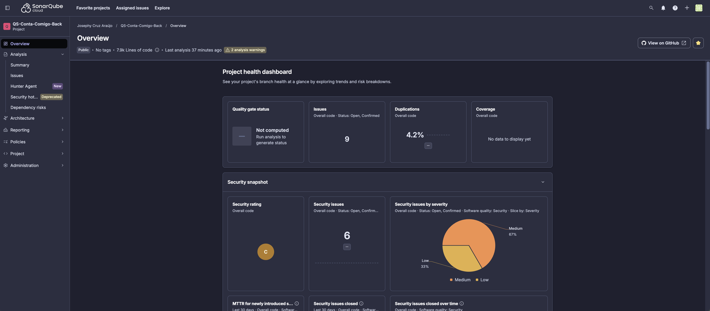
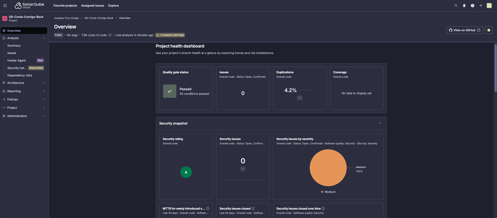

# Relatório — Atividade II.V: Serviço de Qualidade de Código

## 1. Objetivo

A atividade teve como objetivo integrar o backend do sistema Conta Comigo ao SonarQube Cloud, realizar uma análise estática da qualidade do código e corrigir os problemas identificados pela ferramenta, contemplando diferentes categorias de qualidade, como confiabilidade e segurança.

## 2. Análise inicial

Na análise inicial realizada pelo SonarQube Cloud, foram identificados nove apontamentos, distribuídos entre problemas de confiabilidade, segurança e security hotspots.

**Figura 1 — Overview inicial do SonarQube Cloud**

## 3. Problemas identificados e corrigidos

### 3.1. Referência a classe inexistente — Confiabilidade

**Arquivo:** `api/views/__init__.py`

Foi removida a referência a `NotificacaoViewSet` da lista `__all__`, pois a classe não estava definida nem importada no módulo.

### 3.2. Argumento obrigatório ausente — Confiabilidade

**Arquivo:** `api/views/chamados.py`

Foi corrigida a chamada da função `enviar_notificacao`, adicionando o argumento obrigatório `tipo="chamado"`, de acordo com a assinatura da função.

### 3.3. Expressão regular com risco de backtracking excessivo — Confiabilidade

**Arquivo:** `api/utils.py`

Foi substituída uma expressão regular que poderia apresentar desempenho inadequado devido ao backtracking por operações de manipulação de strings. A alteração preservou o comportamento esperado na remoção das informações de campus dos nomes dos cursos.

### 3.4. Instalação de dependências sem restrição a pacotes binários — Segurança

**Arquivos:** `.github/workflows/django-ci.yml` e `Dockerfile`

Foi adicionada a opção `--only-binary=:all:` aos comandos de instalação de dependências com pip, restringindo a instalação a distribuições binárias e evitando a execução de processos de compilação de pacotes durante a instalação.

### 3.5. Instalação de pacotes recomendados automaticamente — Security Hotspots

**Arquivo:** `Dockerfile`

Foi adicionada a opção `--no-install-recommends` aos comandos de instalação dos pacotes `sudo` e `git` com `apt-get`, evitando a instalação automática de pacotes recomendados que não são necessários para o ambiente.

### 3.6. Dependências sem versões resolvidas bloqueadas — Segurança

**Arquivo:** `.github/workflows/django-ci.yml`

Durante a análise do Pull Request, o SonarQube Cloud identificou um apontamento relacionado à regra `githubactions:S8544`, referente ao bloqueio de versões das dependências Python.

O alerta foi identificado como falso positivo, pois o analisador interpretou incorretamente o argumento `:all:` da opção `--only-binary=:all:` como uma dependência sem versão fixada. A ocorrência foi documentada na comunidade oficial da SonarSource, e o apontamento foi marcado como falso positivo no SonarQube Cloud, com justificativa técnica.

## 4. Resultado final

Após a integração das alterações, o SonarQube Cloud apresentou aprovação do Quality Gate e todas as classificações de qualidade passaram a apresentar nota A.

**Figura 2 — Overview final do SonarQube Cloud**

## 5. Conclusão

A atividade permitiu integrar o backend do sistema Conta Comigo ao SonarQube Cloud e identificar problemas em diferentes categorias de qualidade, incluindo confiabilidade, segurança e security hotspots.

As correções realizadas contribuíram para melhorar a confiabilidade do código e reforçar as práticas de segurança na instalação de dependências e na configuração do ambiente.

Com os 133 testes automatizados aprovados, o workflow do GitHub Actions concluído com sucesso, o Pull Request integrado, o Quality Gate aprovado e todas as classificações do SonarQube Cloud com nota A, os objetivos da atividade foram alcançados.